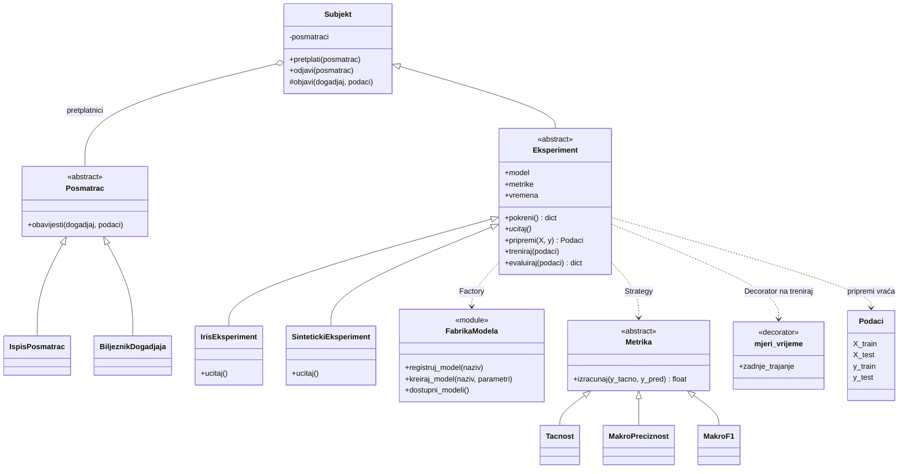

# Mini projekat 2: mini okvir za ML eksperimente

Predmet: Napredno programiranje (FIST4NP), Univerzitet Donja Gorica
Autor: Andrej Zajović

Mali okvir za pokretanje ML eksperimenata nad scikit-learn modelima, izgrađen od pet projektnih šablona.

## Primijenjeni šabloni

| Šablon | Gdje | Šta rješava |
| --- | --- | --- |
| Factory | `ml_okvir/modeli.py` | Kreiranje modela (`linearni`, `stablo`, `knn`) po nazivu, bez lanca `if/elif`. Novi model se dodaje dekoratorom `@registruj_model`. |
| Strategy | `ml_okvir/metrike.py` | Zamjenjive metrike (`tacnost`, `preciznost_makro`, `f1_makro`) iza interfejsa `Metrika.izracunaj`. |
| Observer | `ml_okvir/posmatraci.py` | Eksperiment objavljuje događaje (`pocetak`, `kraj_treninga`, `kraj`), a pretplatnici ih ispisuju ili bilježe. Eksperiment ne zna ko ga prati. |
| Template Method | `ml_okvir/eksperiment.py` | `Eksperiment.pokreni()` fiksira redoslijed ucitaj → pripremi → treniraj → evaluiraj. Podklase prepisuju samo korake koji se razlikuju. |
| Decorator | `ml_okvir/dekoratori.py` | `@mjeri_vrijeme` mjeri trajanje treniranja bez izmjene koda same metode. |

## Dijagram klasa



## Struktura

```
mini_projekat_2/
├── ml_okvir/
│   ├── __init__.py
│   ├── modeli.py         # Factory
│   ├── metrike.py        # Strategy
│   ├── posmatraci.py     # Observer
│   ├── eksperiment.py    # Template Method
│   └── dekoratori.py     # Decorator
├── tests/                # pytest testovi
├── demo_iris.py          # demonstracija na skupu iris
├── pytest.ini
├── requirements.txt
└── README.md
```

## Pokretanje

```bash
pip install -r requirements.txt
python demo_iris.py     # demonstracija na skupu iris
pytest -v               # testovi
```

## Primjer upotrebe

```python
from ml_okvir import IrisEksperiment, IspisPosmatrac

eksperiment = IrisEksperiment("knn", metrike=("tacnost", "f1_makro"), n_neighbors=3)
eksperiment.pretplati(IspisPosmatrac())     # Observer
rezultati = eksperiment.pokreni()           # Template Method
print(rezultati["tacnost"])
print(eksperiment.vremena["treniraj"])      # izmjereno dekoratorom
```

Novi model:

```python
from sklearn.svm import SVC
from ml_okvir import registruj_model

registruj_model("svm")(SVC)                 # fabrika ostaje nepromijenjena
```

Novi izvor podataka: napraviti podklasu `Eksperiment` i prepisati samo `ucitaj()`.

## Demonstracija (iris, podjela 70/30, `random_state=42`)

| model | tačnost | f1_makro |
| --- | --- | --- |
| knn | 0.978 | 0.978 |
| linearni | 0.933 | 0.933 |
| stablo | 0.933 | 0.933 |

Vremena treniranja zavise od računara i ne ispisuju se u tabeli.

## Testovi

Testovi su u `tests/` i pokrivaju:

- Factory: tip modela, nepoznat naziv, prosljeđivanje parametara, proširivanje registra
- Strategy: poznate vrijednosti metrika, izbor po nazivu, greške
- Observer: prijem događaja, više pretplatnika, odjava, dupla pretplata
- Template Method: redoslijed koraka, apstraktna klasa, ponovljivost, dva konkretna eksperimenta
- Decorator: očuvanje rezultata i imena, mjerenje trajanja, rad i kad funkcija baci grešku

## Dizajnerske odluke

- Metrike su klase (a ne samo funkcije) da bi interfejs `Metrika` bio vidljiv u dijagramu. Za ovako male metrike dovoljan bi bio i rječnik funkcija.
- Model je običan scikit-learn estimator; fabrika ga ne omotava u dodatnu klasu jer bi to bio suvišan sloj.
- `treniraj` ima dekorator na osnovnoj klasi. Podklasa koja prepiše `treniraj` treba da ponovo stavi `@mjeri_vrijeme` ako želi mjerenje.

## Upotreba AI alata

> Dopuniti prije predaje, prema onome što je stvarno urađeno.

- **Alat:** Claude (Anthropic).
- **Šta je AI radio:** na osnovu zadatka i slajdova iz nedjelje 3 i 4 predložio je strukturu paketa, napisao kod, testove i nacrt ovog README-a.
- **Šta sam ja provjerio:** _(npr. pokrenuo `pytest` i `demo_iris.py` lokalno, pročitao kod i povezao svaki šablon sa slajdom, promijenio nešto u kodu)_.
- **Odluke o kojima sam odlučivao ja:** _(npr. metrike kao klase umjesto funkcija, izbor modela, dodatni eksperiment)_.
- **Šta je AI predložio, a ja sam odbacio ili izmijenio:** _(ako ima)_.
- **Primjeri prompta:** _(zalijepiti 1-2 stvarna prompta koja si koristio)_.
